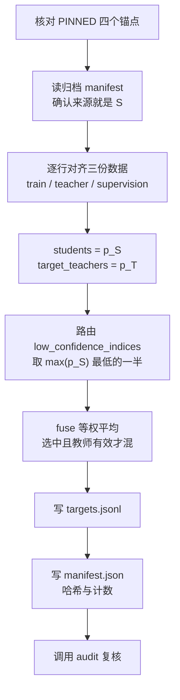

# fusion.py：固定目标、本轮损失、调度与审计（fusion.py 共 590 行）

> 一句话：它有三副面孔——**离线**准备训练目标（`prepare()`）、**在线**给训练循环提供损失与规则（`loss_rows` / `lr_at` / `epoch_order` / `best_key` / `stop_state`）、以及**验收**整份输入有没有被悄悄改过（`audit()`）。

**读完这一篇，你应该能回答：**

1. `targets.jsonl` 里的两份概率分别从哪里来，路由的 5,199 条怎么算出来？
2. 三组的损失到底差在哪一行？为什么 CE_CONT 也计算了 KL？
3. 三组都跑满 650 步，为什么没有触发早停？
4. `audit()` 为什么值得写 47 行检查？它拦住了哪些“看起来能跑”的错误？

---

## 1. 模块级常量（第 26–34 行）

```python
ARMS = ('CE_CONT', 'REF_KD', 'FUSION_KD')
CONFIG = ROOT / 'configs/fusion_continue_20261021.json'
ARCHIVE = '_archive/20260930_legacy_workspace/esci_training/teacher_correct_v1/'
PINNED = {
    'data/posttraining/train.jsonl': 'b6403a21b12ad67f5c1e63f06bd7b33291c52459842007d887b2a0919689f62e',
    'data/posttraining/teacher.jsonl': '988aede6e6d66bfd50ee402f656746bd114fe509734a3c5533bf195adc54ce6f',
    ARCHIVE + 'data/supervision.jsonl': '3f7a5d60e0b8eb9250c84bfb8e85a436ced086e7ebc2ccbfb2165a62cdb30cba',
    'models/S/adapter/adapter_model.safetensors': '96c5ccc5ea9775f5da50ad25701cc8b2b0235b00b5e73943e2d0dff1ed2752da',
}
```

**`ARMS` 的顺序就是训练顺序**：`train()` 用字典推导按 `ARMS` 依次调用 `train_arm()`，所以实际执行是 CE_CONT → REF_KD → FUSION_KD。这是当前唯一的实验组名常量。

**`CONFIG` 写死在这里**：`prepare()` 和命令行默认都用它，入口没有 `--config` 参数。要换实验，改这份文件或改这一行——没有第三条路。

**`PINNED` 是四个“不可变锚点”**，把本轮结果钉死在一组具体文件上：

| 锚点 | 为什么必须是它 |
| --- | --- |
| `data/posttraining/train.jsonl` | 本轮 10,398 条训练样本；换一批样本，目标、训练、结果全部不可比 |
| `data/posttraining/teacher.jsonl` | 教师概率缓存；它是 `q` 里 `p_T` 的唯一来源，**不再发 API 请求** |
| `_archive/.../supervision.jsonl` | 原模型 S 的历史概率 `p_S`；比 `teacher.jsonl` 早一代的归档 |
| `models/S/adapter/adapter_model.safetensors` | 三组的共同起点；换掉它，“续训”就不再是从 S 出发 |

`ARCHIVE` 指向 `_archive/` 下的历史工作区，**没有随公开仓库发布**。所以 `prepare()` 只能在保留该归档的机器上跑；已有 `targets.jsonl` 的运行不需要它（见[目录与复现说明 §6.3](../目录与复现说明.md)）。

---

## 2. 概率合法性检查 `probs_ok()`（第 38–41 行）

```python
def probs_ok(p):
    require(set(p) == set(LABELS), 'Probability labels must be E,S,C,I')
    require(all(math.isfinite(v) and 0 <= v <= 1 for v in p.values()), 'Invalid probability')
    require(abs(sum(p.values()) - 1) < 1e-5, 'Probability sum mismatch')
```

三个条件：键集合恰好是四个标签、每个值有限且落在 `[0,1]`、和为 1（误差 1e-5）。`set(p) == set(LABELS)` 不检查顺序——顺序由使用方按 `LABELS` 取值保证。

它只用于 `prepare()` 和 `audit()`，不在训练热路径上。

---

## 3. `prepare()`：目标怎样被造出来（第 44–105 行）

这是唯一会**写** `data/fusion_continue_20261021/` 的函数。整体流程：



### 3.1 前置断言（第 45–53 行）

```python
    cfg = read_json(CONFIG)
    for name, expected in PINNED.items():
        require(digest(ROOT / name) == expected, 'Source hash mismatch: ' + name)
    old_manifest = read_json(ROOT / ARCHIVE / 'data_manifest.json')
    require(old_manifest['checkpoints']['S']['adapter_sha256'] == cfg['initial_adapter_sha256'],
            'Archived probability source is not S')
    require(old_manifest['files']['supervision.jsonl'] == PINNED[ARCHIVE + 'data/supervision.jsonl'],
            'Archived supervision manifest mismatch')
    require(old_manifest['files']['train.jsonl'] == PINNED[cfg['train']], 'Archived train mismatch')
```

在动笔之前先证明“我要读的四份材料确实是我以为的那四份”：

- 四个 SHA256 全部对上；
- 归档清单说它的概率来自 S（`checkpoints.S.adapter_sha256` 等于配置里的 `initial_adapter_sha256`）；
- 归档清单记录的 `supervision.jsonl`、`train.jsonl` 哈希也与本轮锚点一致。

**这一步防的是“张冠李戴”**：`supervision.jsonl` 里有原模型的四类概率，如果它其实来自另一个模型（比如更早的一代），那么 `p_S` 就不是 S 的概率，整个 REF_KD 组的含义都会变。哈希是唯一可靠的证据。

### 3.2 逐行对齐三份数据（第 54–69 行）

```python
    rows = read_jsonl(ROOT / cfg['train'])
    teachers = read_jsonl(ROOT / 'data/posttraining/teacher.jsonl')
    old = read_jsonl(ROOT / ARCHIVE / 'data/supervision.jsonl')
    require(len(rows) == len(teachers) == len(old) == 10398, 'Source coverage mismatch')
    students, target_teachers = [], []
    for r, t, s in zip(rows, teachers, old):
        require(all(r[k] == t[k] == s[k] for k in ('example_id','query_id','product_id','label')),
                'Source row identity mismatch')
        require(t['probabilities'] == s['probabilities'], 'Teacher source mismatch')
        require(bool(t['teacher_available']) == (t['probabilities'] is not None), 'Teacher availability mismatch')
        probs_ok(s['reference'])
        if t['probabilities'] is not None:
            probs_ok(t['probabilities'])
        identity = {k: r[k] for k in ('example_id','query_id','product_id')}
        students.append(dict(identity, probabilities=s['reference']))
        target_teachers.append(dict(identity, probabilities=t['probabilities']))
```

三个要点：

1. **按位置 `zip`，但逐行验身份。** 三份文件必须行序一致；`example_id`/`query_id`/`product_id`/`label` 四个字段全等才算对齐。如果有人重排过其中一份，这里立刻失败。
2. **`p_S` 取自归档的 `s['reference']`**，不是取自 `teacher.jsonl`。`teacher.jsonl` 里也有 `probabilities`，但那是**教师**的概率。代码用 `t['probabilities'] == s['probabilities']` 断言“本轮教师缓存与归档里记录的教师概率一致”，说明这两份文件来自同一次教师调用。
3. **`teacher_available` 与 `probabilities is not None` 必须一致**；有效教师还要再 `probs_ok` 一次。

于是得到两个中间列表：`students[i]['probabilities'] = p_S[i]`，`target_teachers[i]['probabilities'] = p_T[i]`（可能 `None`）。

### 3.3 路由与融合（第 70–71 行）

```python
    route = low_confidence_indices(students)
    fused = fuse(students, target_teachers, route)
```

只用两行，但决定了整个方法的性格：

- `low_confidence_indices(students)` 只看 `p_S` 的最大值，**不看标签、不看教师对错**（[01 §7.1](01-common.md)）。10,398 条里取 `ceil(N/2) = 5,199` 条。
- `fuse(students, target_teachers, route)` 对选中的行做 `(p_S+p_T)/2`；教师缺失时回退到 `p_S`（[01 §7.2](01-common.md)）。

`route` 是**索引集合**，后面用 `i in route` 判断；`fused` 是完整的 10,398 行，未选中的行概率等于 `p_S`。

### 3.4 写出每条样本的两列概率（第 72–82 行）

```python
    targets = []
    for i, (r, s, t, q) in enumerate(zip(rows, students, target_teachers, fused)):
        targets.append({**{k: r[k] for k in ('example_id','query_id','product_id','label')},
                        'reference_probabilities': s['probabilities'],
                        'fusion_probabilities': q['probabilities'],
                        'route_selected': i in route,
                        'teacher_available': t['probabilities'] is not None,
                        'teacher_used': i in route and t['probabilities'] is not None})
    out = ROOT / cfg['targets']
    fresh_dir(out.parent)
    write_jsonl(out, targets)
```

每行九个字段，可以分成三组：

| 字段 | 类型 | 谁用 |
| --- | --- | --- |
| `example_id` / `query_id` / `product_id` / `label` | 身份与真实类别 | `audit()` 对齐、训练时取标签 |
| `reference_probabilities` | `p_S`，四类字典 | REF_KD 与 CE_CONT 取它（CE_CONT 只记录） |
| `fusion_probabilities` | `q`，四类字典 | FUSION_KD 取它 |
| `route_selected` / `teacher_available` / `teacher_used` | 三个布尔 | 审计与事后分析；训练不使用 |

注意 `teacher_used = route_selected and teacher_available`：这就是那 5,195 条的来源。

`fresh_dir(out.parent)` 保护的是 `data/fusion_continue_20261021/` 这个**目录**（不是文件）。目录里已有 `targets.jsonl` 时直接报 `Refuse nonempty output`，所以**不能覆盖重跑**；要重做目标，必须先自己清空目录（并承担“这是一次新目标”的后果）。

### 3.5 写清单（第 83–104 行）

```python
    input_keys = ['train','tune','gate','final_input','final_gold','final_teacher']
    pinned_files = {cfg[k]: digest(ROOT / cfg[k]) for k in input_keys}
    pinned_files.update({k: v for k, v in PINNED.items() if not k.startswith('_archive/')})
    pinned_files['models/S/adapter/adapter_config.json'] = digest(ROOT / 'models/S/adapter/adapter_config.json')
    pinned_files[cfg['targets']] = digest(out)
    write_json(ROOT / cfg['target_manifest'], {...})
```

`files_sha256` 最终恰好 **10 个键**：

- 配置里 6 个输入：训练集、tune、gate、F 输入、F 标签、F 教师缓存；
- `PINNED` 里除归档外的 3 个，其中训练集与配置重复、字典覆盖后新增 2 个：教师缓存、S adapter 权重；
- S adapter 的 `adapter_config.json`；
- 刚写出的 `targets.jsonl` 自己。

`6 + 2 + 1 + 1 = 10`。可以用下面这条命令数一遍：

```powershell
python -c "import json; m=json.load(open('data/fusion_continue_20261021/manifest.json',encoding='utf-8')); print(len(m['files_sha256']))"
```

然后是 manifest 的元信息，其中几项值得单独看：

```python
        'status': 'ready_for_S_initialized_continuation; training_not_started',
        ...
        'route_selected': 5199, 'teacher_available': 10387, 'teacher_used': 5195,
        'routed_teacher_failures': 4, 'reference_only_targets': 5203,
        'extra_training_rows': 0, 'api_calls': 0, 'model_forwards': 0,
        'route': 'lowest max(p_S), ceil(N/2); SHA256 esci-cascade-v13|example_id tie-break',
        'target': '(p_S+p_T)/2 on routed valid rows; p_S otherwise',
        'gold_or_teacher_correctness_used_in_target': False,
        'teacher_probabilities': 'existing cache only; no API',
        'initialization': 'all arms load models/S adapter; fresh optimizer and RNG',
        'generator_sha256': digest(Path(__file__)),
```

**四个计数之间的关系**（记住这一组，审计和文档反复用到）：

| 计数 | 值 | 含义 |
| --- | ---: | --- |
| `route_selected` | 5,199 | `ceil(10398/2)`，被路由选中 |
| `teacher_available` | 10,387 | 教师缓存里有概率的行（11 条缺失） |
| `teacher_used` | 5,195 | 既被选中、又有教师概率 |
| `routed_teacher_failures` | 4 | 被选中但教师缺失 = 5,199 − 5,195 |
| `reference_only_targets` | 5,203 | 目标等于 `p_S` 的行 = 10,398 − 5,195 |

最后一行 `'generator_sha256': digest(Path(__file__))` 把生成这份目标的**代码**也钉进去：同样的输入、不同的 `prepare()` 实现，算出的目标可能不同。

`print(audit(cfg)['counts'])`（第 105 行）在写完立刻回读并用 `audit()` 全面复核一遍，形成“写完就验”的闭环。

---

## 4. 数据顺序 `epoch_order()`（第 108–111 行）

```python
def epoch_order(n, seed, epoch):
    order = list(range(n))
    random.Random(seed + epoch).shuffle(order)
    return order
```

- 每个 epoch 一个独立的 `Random(seed + epoch)`：epoch 0 用 `Random(20261001)`，epoch 1 用 `Random(20261002)`，互不影响，也不依赖前一个 epoch 用掉了多少随机数。
- 返回 `0..n-1` 的一个排列，是**索引**而不是数据本身。`train_arm()` 保存了编码好的 `features` 列表，靠这个索引取样本。
- 两轮各自都是完整排列，保证“每条样本每轮恰好出现一次”。`audit()` 用 `len(set(order)) == len(train)` 和哈希来验证这一点。
- `n` 传入的是 `len(features) = 10,398`。

第一阶段 SFT 使用 `common.epoch_groups()`；第二阶段三组共享这里的完整行排列。

---

## 5. 学习率 `lr_at()`（第 114–119 行）

```python
def lr_at(step, cfg):
    """LR used by a 1-based optimizer update, with explicit nonzero cosine floor."""
    if step <= cfg['warmup_updates']:
        return cfg['learning_rate'] * step / cfg['warmup_updates']
    progress = (step - cfg['warmup_updates']) / (cfg['max_updates'] - cfg['warmup_updates'])
    return cfg['min_learning_rate'] + (cfg['learning_rate'] - cfg['min_learning_rate']) * (1 + math.cos(math.pi * progress)) / 2
```

**`step` 是 1-based**：第 1 次更新对应 `lr_at(1)`。`train_arm()` 在自增之前调用 `lr_at(step + 1)`，正好对应“即将执行的那次更新”。

- 预热段（1 ≤ step ≤ 33）：从 `2e-5 × 1/33` 线性升到 `2e-5`。
- 余弦段（33 < step ≤ 650）：`progress` 从 0 到 1，`cos` 从 1 到 −1，系数从 1 降到 0，学习率从 `2e-5` 平滑降到 `2e-6`。
- 分母是 `650 − 33 = 617`，所以第 650 步刚好 `progress = 1`。
- 下限不是 0 而是 `min_learning_rate = 2e-6`：最后仍保留一点步长，避免完全停住。

实际取值（可由配置复算）：

| step | 1 | 33 | 82 | 325 | 488 | 650 |
| --- | ---: | ---: | ---: | ---: | ---: | ---: |
| 学习率 | 6.06e-7 | 2.00e-5 | 1.972e-5 | 1.176e-5 | 4.892e-6 | 2.00e-6 |

`cpu_checks()` 断言 `lr_at(33) == 2e-5`、`lr_at(650) == 2e-6`，把这两个端点写成了测试。

> 注意 `lr_at(650)` 是**第 650 次更新用过的学习率**（那次更新发生在 step 649 → 650 的循环里），不是“第 650 步更新之后”的学习率。第 650 次更新完成后做评测，不再执行第 651 次更新，见 [06 数字推演](06-一次更新的数字推演.md) 第 7.1 节。

---

## 6. 本轮损失 `loss_rows()`（第 122–130 行）

```python
def loss_rows(logits, labels, target, arm, weight=1.0):
    import torch.nn.functional as F
    require(arm in ARMS, 'Unknown arm')
    logp = F.log_softmax(logits.float(), dim=-1)
    ce = F.nll_loss(logp, labels, reduction='none')
    # kl_div implements 0*log(0)=0 without perturbing or smoothing the target.
    kl = F.kl_div(logp, target.float(), reduction='none').sum(-1)
    loss = ce if arm == 'CE_CONT' else (ce + weight * kl) / (1 + weight)
    return loss, ce, kl
```

### 6.1 逐个参数

| 参数 | 形状 | 来源 |
| --- | --- | --- |
| `logits` | `[B, 4]` | `RelevanceModel.forward()` |
| `labels` | `[B]`，0–3 | `LABELS.index(row['label'])` |
| `target` | `[B, 4]` | `targets` 张量按本批索引取出的一行行 |
| `arm` | 字符串 | `ARMS` 之一 |
| `weight` | 标量 | 配置 `lambda_soft`，本轮为 1.0 |

### 6.2 三行核心

```python
    logp = F.log_softmax(logits.float(), dim=-1)
    ce = F.nll_loss(logp, labels, reduction='none')
    # kl_div implements 0*log(0)=0 without perturbing or smoothing the target.
    kl = F.kl_div(logp, target.float(), reduction='none').sum(-1)
```

- **`log_softmax`**：先减最大值再取 log，数值稳定。返回 `[B, 4]` 的 log 概率。
- **`nll_loss`**：按 `labels` 取出对应列，取负号，得到每条样本的 `−log p(y)`。`reduction='none'` 表示**不汇总**，保留 `[B]`，由调用方决定怎样平均（这是梯度累积能按实际行数归一的前提）。
- **`kl_div(input=logp, target=q)`**：计算 `q·(log q − logp)`，逐类求和后得到 `[B]`。第一个参数是**log 概率**，第二个是**概率本身**——顺序写反不会报错，但结果完全错误，是最常见的误用。

`kl_div` 对 `q=0` 的处理是 `0·log0 = 0`，不会产生 `NaN`。注释专门说明这一点，因为手写 `q * (q.log() - logp)` 在 `q=0` 时会出现 `0 × (-inf) = NaN`。`cpu_checks()` 里把 `q[:, 3]` 置零正是为了测这个。

### 6.3 三组的差别只有一行

```python
    loss = ce if arm == 'CE_CONT' else (ce + weight * kl) / (1 + weight)
```

| arm | 损失 | 本轮 `weight=1` 时 |
| --- | --- | --- |
| `CE_CONT` | `ce` | `ce` |
| `REF_KD` | `(ce + w·kl)/(1+w)` | `(ce + kl)/2` |
| `FUSION_KD` | `(ce + w·kl)/(1+w)` | `(ce + kl)/2` |

两个软监督组的公式完全相同，区别只在**传进来的 `target` 是哪一列**：`train_arm()` 里

```python
    field = 'fusion_probabilities' if arm == 'FUSION_KD' else 'reference_probabilities'
```

所以 REF_KD 的 KL 对齐 `p_S`，FUSION_KD 的 KL 对齐 `q`。损失函数本身不需要知道这件事——这是把“用什么目标”和“怎样算损失”解耦的设计。

`(ce + w·kl)/(1+w)` 中的 `/ (1+w)` 让两项权重之和为 1：`w=1` 时两者各占一半。这也解释了为什么不直接写 `0.5*ce + 0.5*kl`：`w` 可调，归一化方式随 `w` 变化。

### 6.4 一个容易误读的地方：CE_CONT 也会计算并记录 KL

CE_CONT 的 `loss` 只有 `ce`，但 `kl` **照样被算出来并返回**。`train_arm()` 把它写进更新日志：

```python
record = dict(..., loss=sums[0]/len(indices), ce=sums[1]/len(indices),
              kl=sums[2]/len(indices), soft_coefficient=0 if arm=='CE_CONT' else cfg['lambda_soft'], ...)
```

所以 `runs/.../CE_CONT/updates_*.jsonl` 里每行都有一个非零的 `kl`，而 `soft_coefficient` 是 0。这不是 bug，而是刻意的诊断信息：它回答“如果这一组也用软监督，KL 项会有多大”。实际日志里 CE_CONT 的 `kl` 从第 1 步的 0.0006 涨到最后一步的 0.206——模型越训越离开原模型 S，这正是 REF_KD/FUSION_KD 想约束的方向。

读代码时不要因为看到 `kl` 就以为 CE_CONT 也用了软监督；**看 `loss` 的构造，不看日志字段**。

### 6.5 手算一个例子

设某条样本 `q = [0.5, 0.3, 0.15, 0.05]`，学生对四类的概率 `p = [0.40, 0.35, 0.20, 0.05]`，真实标签是 E（第 0 类）。

- `CE = −ln 0.40 = 0.9163`
- `KL(q‖p) = Σ q·ln(q/p)`
  - E：`0.5 × ln(1.25) = +0.1116`
  - S：`0.3 × ln(0.8571) = −0.0462`
  - C：`0.15 × ln(0.75) = −0.0432`
  - I：`0.05 × ln(1.0) = 0`
  - 合计 `= 0.0222`
- 软监督组损失 `= (0.9163 + 0.0222) / 2 = 0.4692`

这个例子说明：当学生的分布已经接近目标时，KL 很小，损失几乎等于 CE；KL 起作用的主要是“学生把概率分错地方”的样本。

---

## 7. 选点与早停：`best_key()` 与 `stop_state()`（第 133–145 行）

### 7.1 `best_key()`（第 133–134 行）

```python
def best_key(point):
    return point['macro_f1'], point['ndcg10'], -point['step']
```

`train_arm()` 末尾用 `max(history, key=best_key)` 选最佳存档。元组比较是**字典序**：

1. 先比 tune Macro-F1，越高越好；
2. 完全相等时比 nDCG@10；
3. 再相等时比 `-step`，即**步数越小越好**（越早越好）。

`-step` 的作用是让“完全相同成绩”时选更早的存档：更早意味着更少的训练曝光，也意味着更不容易过拟合。当前只有 `best_key()` 执行这一规则，精确比较，不先四舍五入。

### 7.2 `stop_state()`（第 137–145 行）

```python
def stop_state(history, cfg):
    reference, stale = history[0]['macro_f1'], 0
    for point in history[1:]:
        if point['macro_f1'] >= reference + cfg['early_stop_min_delta']:
            reference, stale = point['macro_f1'], 0
        else:
            stale += 1
    return {'meaningful_best': reference, 'stale_evaluations': stale,
            'stop': history[-1]['step'] >= cfg['min_updates'] and stale >= cfg['early_stop_patience']}
```

这是一条“**累计显著改善**”规则，不是“连续 N 次不刷新最佳值”那种常见写法：

- `reference` 初始为第 0 步（基线）的 Macro-F1。
- 每次评测，只有**超过 reference 至少 `early_stop_min_delta = 0.001`** 才算“有意义的进步”，此时刷新 reference 并把 `stale` 清零。
- 否则 `stale += 1`。
- 停止需要两个条件同时满足：**当前步 ≥ `min_updates = 325`**（至少跑一半）且 **`stale ≥ patience = 4`**。
- 函数每次都从 `history[0]` 重算，不做增量状态，所以可以随时对任意历史调用。

`cpu_checks()` 里专门测了一个反直觉场景：Macro-F1 依次为 `.4, .4004, .4008, .4012`，每次只涨 0.0004。如果按“是否刷新最大值”算，会认为一直没进步；但按累计规则，从 `.4` 到 `.4012` 累计涨了 0.0012，**大于 0.001**，所以第 4 次评测会把 `stale` 清零。测试断言 `stale_evaluations == 0`，防止有人把规则“优化”成逐次比较。

### 7.3 三组为什么都没早停

用 `selected_all.json` 里保存的 history 复算（数值来自真实运行）：

| 组 | 评测步上的 Macro-F1（0→650） | 最终 `stale` |
| --- | --- | ---: |
| CE_CONT | .4744 / .4635 / .4784 / .4856 / .4633 / .4893 / .4912 / .4916 / .4902 | 2 |
| REF_KD | .4744 / .4720 / .4925 / .4918 / .4811 / .4937 / .4963 / .4968 / .4913 | 2 |
| FUSION_KD | .4744 / .4729 / .4885 / .4995 / .4777 / .4918 / .5006 / .4939 / .4953 | 2 |

`stale` 最多到 2，从未达到 4，所以三组都跑满 650 步，停止原因记为 `budget_exhausted`。这条规则在“成绩震荡但仍有小幅提升”时不会误停——这正是它想要的性格。

---

## 8. `audit()`：整份输入的契约测试（第 148–195 行）

`audit()` 有 48 行，几乎全是 `require`。它是本项目最重要的“防呆”函数：任何一次训练、评测、预检之前都会先跑它。

```python
def audit(cfg):
    require(tuple(cfg['arms']) == ARMS, 'Wrong arms')
    require(cfg['lambda_soft'] == cfg['temperature'] == 1, 'Frozen loss contract changed')
    manifest = read_json(ROOT / cfg['target_manifest'])
    for name, expected in manifest['files_sha256'].items():
        require(digest(ROOT / name) == expected, 'Input hash mismatch: ' + name)
    require(manifest['reference_adapter_sha256'] == cfg['initial_adapter_sha256'] ==
            PINNED['models/S/adapter/adapter_model.safetensors'], 'S identity changed')
    ...
```

检查项按顺序可以分成九组：

| 组 | 行号 | 检查什么 | 失败说明什么 |
| --- | --- | --- | --- |
| 组名与损失契约 | 149–150 | `arms` 元组、`lambda_soft` 与 `temperature` 必须都是 1 | 有人改了实验配方 |
| 输入哈希 | 151–153 | manifest 里 10 个文件的 SHA256 | 输入被替换、重新生成或损坏 |
| S 身份 | 154–155 | manifest、配置、`PINNED` 三处的 S adapter 哈希必须一致 | 起点不是同一个 S |
| 覆盖与唯一性 | 156–161 | 三份文件都 10,398 行；train 身份唯一；512 个查询 | 样本被增删或重复 |
| 路由与融合复算 | 162–179 | 用 `p_S` 重算路由；逐行核对两列概率、三个布尔、融合值 | 目标文件被手改，或路由规则变了 |
| 计数锁定 | 180 | `(5199, 10387, 5195)` | 覆盖率变化 |
| 评测划分与隔离 | 181–185 | tune 5,223 / gate 10,438 / F 10,459；四个集合两两不重叠 | 数据泄漏或划分变动 |
| 训练契约 | 186–188 | 32/4 批、650 步 2 轮、9 个评测步 | 预算或评测节奏被改 |
| 数据顺序 | 189–191 | 每个 epoch 是完整排列，输出两个哈希 | 采样方式变了 |

### 8.1 逐行核对融合值（第 166–179 行）

```python
    for i, (r,t,c) in enumerate(zip(train, targets, teacher)):
        require(all(r[k] == t[k] == c[k] for k in ('example_id','query_id','product_id','label')), 'Target identity mismatch')
        for field in ('reference_probabilities','fusion_probabilities'):
            probs_ok(t[field])
        valid = c['probabilities'] is not None
        require(t['teacher_available'] == valid == bool(c['teacher_available']), 'Availability mismatch')
        require(t['route_selected'] == (i in route), 'Route mismatch')
        mix = i in route and valid
        require(t['teacher_used'] == mix, 'Teacher-used mismatch')
        expected = {k: (t['reference_probabilities'][k] + c['probabilities'][k])/2
                    if mix else t['reference_probabilities'][k] for k in LABELS}
        require(expected == t['fusion_probabilities'], 'Fusion value mismatch')
```

这一段等于把 `prepare()` 的核心逻辑**独立重写了一遍**再比对：

- 用 `reference_probabilities` 重算路由（`i in route`），验证 `route_selected`；
- 用 `teacher.jsonl` 判断教师是否有效，验证 `teacher_available`；
- 重新算 `(p_S+p_T)/2` 或 `p_S`，**精确等于** `fusion_probabilities` 才算通过。

注意这里是 `==` 而不是 `allclose`：概率是同一套浮点运算产生的，应当逐位相同。如果哪天 `prepare()` 改了运算顺序（例如先求和再除、或先转 float32），这里会失败——这正是它的价值。

### 8.2 数据隔离（第 184 行）

```python
    isolation = check_isolation({'train':train,'tune':tune,'gate':gate,'F':final_input})
```

`check_isolation()` 在 [evaluation.py](../../src/evaluation.py#L17-L30)，检查四个集合两两之间的 `query_id`、归一化查询文本、`example_id` 是否完全不相交。实际运行的结果是全零：

```
train_vs_tune 0/0/0, train_vs_gate 0/0/0, train_vs_F 0/0/0,
tune_vs_gate 0/0/0,  tune_vs_F 0/0/0,  gate_vs_F 0/0/0
```

它防的是“同一个查询出现在训练集和评测集里”——那会让指标虚高。注意它检查的是**查询级**隔离（包括归一化后文本相同的查询），比只查 `example_id` 更严。

### 8.3 为什么值得这么严

`audit()` 的每个 `require` 都对应一次真实可能发生的错误。举三个例子：

- 把 `lambda_soft` 改成 0.5：第 150 行立刻报 `Frozen loss contract changed`。损失变成 `(ce+0.5*kl)/1.5`，与已发布结果的“各占一半”不可比。
- 手动往 `targets.jsonl` 加一行：第 159 行行数不对；即使行数对，第 180 行的计数也会不对。
- 重新生成 `targets.jsonl`（哪怕内容相同）：`files_sha256` 里的哈希会变，`run_manifest.json` 对不上，`--evaluate` 会拒绝。

**它把“实验身份”从口头约定变成了可执行的断言。** 代价是每次启动都要重新哈希约 21 MB 输入加 40 MB adapter（`audit` 在 `preflight`、`train`、`final_evaluation` 里各跑一次），换来的是“不可能在错误的输入上跑出看起来正常的数字”。

返回值同时充当数据容器：`{'counts':…, 'epoch_order_sha256':…, 'isolation':…, 'train':…, 'targets':…, 'tune':…}`。`train()` 把它直接传给 `train_arm()`，避免重复读文件。

---

## 9. `cpu_checks()`：不加载模型的自测（第 198–225 行）

```python
def cpu_checks(cfg):
    """Synthetic autograd only; no model weights, dataset training, or optimizer step."""
    import torch
    import torch.nn.functional as F
    torch.manual_seed(97)
    for n in [32,30]:
        x = torch.randn(n,4,requires_grad=True)
        y = torch.arange(n) % 4
        q = torch.rand(n,4)
        q[:,3] = 0
        q /= q.sum(-1,keepdim=True)
        for arm in ARMS:
            a = x.detach().clone().requires_grad_(True)
            loss,ce,kl = loss_rows(a,y,q,arm)
            loss.mean().backward()
            expected = F.cross_entropy(a,y) if arm == 'CE_CONT' else (
                F.cross_entropy(a,y) + F.kl_div(F.log_softmax(a,dim=-1),q,reduction='batchmean'))/2
            require(torch.allclose(loss.mean(),expected,atol=1e-6), 'Loss formula mismatch')
            b = x.detach().clone().requires_grad_(True)
            for start in range(0,n,4):
                z,_,_ = loss_rows(b[start:start+4],y[start:start+4],q[start:start+4],arm)
                (z.sum()/n).backward()
            require(torch.allclose(a.grad,b.grad,atol=1e-7), 'Tail/microbatch gradients differ')
            require(torch.isfinite(a.grad).all().item(), 'Nonfinite gradient at zero target')
    history = [dict(step=i*82,macro_f1=v,ndcg10=.7) for i,v in enumerate([.4,.4004,.4008,.4012])]
    require(stop_state(history,cfg)['stale_evaluations'] == 0, 'Cumulative small improvements lost')
    require(abs(lr_at(33,cfg)-2e-5)<1e-12 and abs(lr_at(650,cfg)-2e-6)<1e-12, 'LR endpoints wrong')
    print('PASS synthetic loss, zero probabilities, 32/30-row accumulation, early stopping and LR')
```

它用**随机数**代替真实数据，只验证四件事：

1. **损失公式**：`loss_rows()` 的平均值必须等于独立写出的 `F.cross_entropy`（以及加 `F.kl_div(..., reduction='batchmean')`）——用两种写法互相对照，防止公式抄错。
2. **零概率安全**：`q[:,3] = 0` 再归一化，制造“某个类别目标概率为 0”的情况，断言梯度有限。手写 KL 在这里会出 `NaN`，`F.kl_div` 不会。
3. **批大小与梯度累积等价**：对同一批 32 条（和 30 条的尾批），一次算完的梯度必须等于按 4 条切块、每块 `sum()/n` 反向累积的梯度（`atol=1e-7`）。这保证了训练循环里的梯度累积**数学上等于**大 batch 训练。
4. **调度与早停**：累计改善规则与学习率端点。

`n` 取 `[32, 30]` 正好对应正常批和尾批。`requires_grad_(True)` 与 `detach().clone()` 是为了让每个 arm 从同一份初始张量出发，不共享梯度。

注意它 `import torch`，所以 `--preflight` 需要装 PyTorch——这与“`fusion.audit()` 只依赖标准库”是两回事。`cpu_checks()` 不读数据、不加载模型、不做优化器更新，跑完只需一秒。

---

## 10. 统一入口与目标生命周期

`train.py` 分发 `fusion` 子命令到 `fusion.main()`；目标、损失和训练循环已在同一模块。`--preflight` 会执行 `audit()` 与 `cpu_checks()`，然后验证 tokenizer 与模型身份；`--train` 明确开始续训。帮助命令不需要 torch：

```bash
python src/train.py fusion --help
python src/train.py fusion --preflight
```

`prepare()` 的完整实现保留为内部函数，用于从已有概率构造全新的目标目录。它不会在当前 CLI 中自动执行；现有目标目录只读复用。

没有 torch 时，仍可单独只读调用 `audit()`，输出 rows=10398、queries=512、soft_loss_rows=10398、routed=5199、teacher_used=5195、tail_batch=30。完整 CPU 预检需要 torch 和 tokenizer。

---

## 11. 本文件维护的不变量

1. **目标固定**：`targets.jsonl` 一旦生成，训练期间不再根据标签、教师对错或学生置信度调整。
2. **路由只用 `p_S` 的最大值**，并列靠固定哈希；选中比例恰好 `ceil(N/2)`。
3. **融合只在被选中且教师有效的行上发生**，其余行 `q = p_S`。
4. **软监督系数与温度恒为 1**，损失是 `(ce + kl)/2`。
5. **学习率 1-based，端点 2e-5 / 2e-6，warmup 33 步**。
6. **早停看累计改善 ≥ 0.001，连续 4 次不足才停，且不早于 325 步**。
7. **输入、配置、目标、S adapter 的哈希与计数全部锁定**。

---

## 12. 坑与细节

| 现象 | 解释 |
| --- | --- |
| CE_CONT 日志里有 `kl` | 算了但未进损失；`soft_coefficient=0` |
| `prepare()` 报 `Refuse nonempty output` | 目标目录已存在且非空；不能覆盖 |
| `audit()` 报 `Frozen loss contract changed` | `lambda_soft` 或 `temperature` 不是 1 |
| `audit()` 报 `Fusion value mismatch` | 目标文件被手改，或 `prepare()` 实现变了 |
| 路由数量是 5,199 而不是 5,198 | `ceil(10398/2)`，故意多数一条 |
| `teacher_used=5,195` 比 `route_selected` 少 4 | 这 4 条被选中但教师缓存缺失，回退到 `p_S` |
| 最终 `stale` 是 2，为什么不停 | 停止要求 `stale ≥ 4` |
| `lr_at(650)` 还能取到 2e-6 | 第 650 次更新确实发生了，用的就是 `lr_at(650)`；没有第 651 次更新 |

---

## 13. 自测

1. 如果 `route_selected` 改成取 `floor(N/2)`，哪些数字会变？`audit()` 会在哪一行失败？
2. 把 `weight` 从 1 改成 2，损失公式变成什么？为什么 `audit()` 不允许？
3. 为什么 `audit()` 用 `==` 比较融合概率，而不是 `allclose`？
4. `stop_state()` 为什么从 `history[0]` 重算，而不是在 `train_arm()` 里维护计数器？
5. `cpu_checks()` 为什么要把 `n` 取 32 和 30 两个值？

参考思路：1 `route` 5,198、`teacher_used` 可能 5,194，第 180 行计数断言失败；2 `(ce+2kl)/3`，配置契约被改；3 同一套运算应逐位复现，用 `allclose` 会放过“运算顺序变了”的情况；4 纯函数更容易测试、可在任意历史点上调用；5 覆盖完整批与尾批两种分母。

---

## 14. 验证

```powershell
# 只读审计，不加载模型、不创建目标
python -B -c "import sys; sys.path.insert(0,'src'); from fusion import audit,CONFIG; from common import read_json; print(audit(read_json(CONFIG))['counts'])"

# 输入、tokenizer 与合成损失/梯度检查，需要 torch
python src/train.py fusion --preflight

# 手算 (CE+KL)/2
python -c "import math; q=[.5,.3,.15,.05]; p=[.4,.35,.2,.05]; ce=-math.log(p[0]); kl=sum(a*math.log(a/b) for a,b in zip(q,p)); print(round(ce,4), round(kl,4), round((ce+kl)/2,4))"
```

手算输出 `0.9163 0.0222 0.4692`。合成检查覆盖目标零概率、32/30 条的 microbatch 累积、早停与学习率端点。

下一站：[04 训练编排](04-training.md) —— 这些规则怎样被一个 650 步的循环执行。
