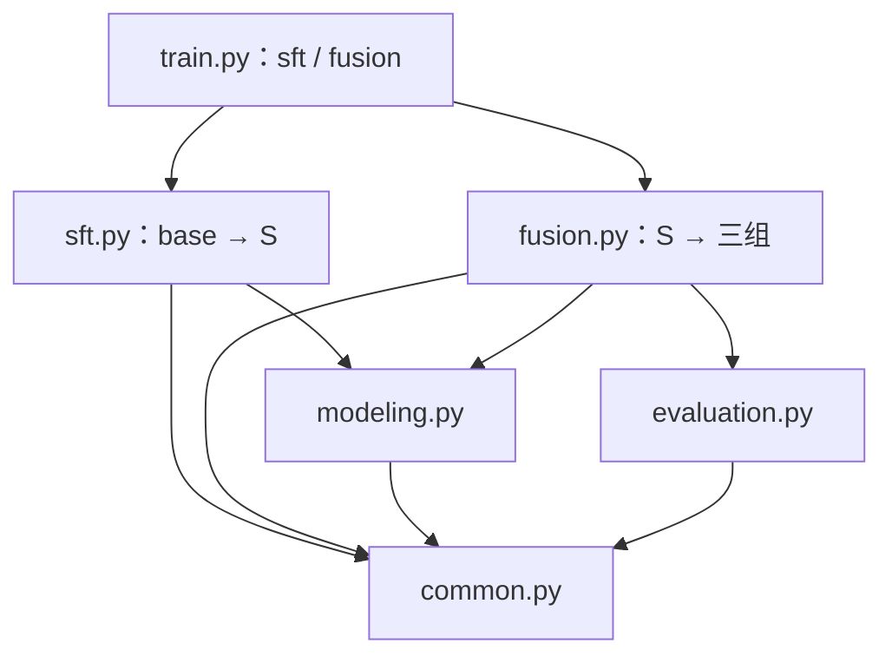

# 源码导读：6 个文件，两段训练

当前代码对应官方底座 → S → CE_CONT / REF_KD / FUSION_KD。2026-10-22 的模块重构保留数值函数原文；下列行号均按重构后的实际源码更新。历史报告与配置不改写，旧 `run_manifest.json` 的源码身份不用于新运行。

| 文件 | 行数 | 职责 |
| --- | ---: | --- |
| [train.py](../../src/train.py) | 22 | 唯一 CLI，只分发 sft / fusion |
| [sft.py](../../src/sft.py) | 161 | 官方底座 → S；输入核验、分组 SFT、tune 选点 |
| [fusion.py](../../src/fusion.py) | 590 | 固定目标、审计、损失与调度、三组续训、选点、评测和查询 Bootstrap |
| [evaluation.py](../../src/evaluation.py) | 80 | 查询隔离、教师弃权指标与 NLL |
| [common.py](../../src/common.py) | 249 | 数据契约、编码、指标、路由和等权融合 |
| [modeling.py](../../src/modeling.py) | 96 | Qwen + LoRA、四标签前向、预测与保存 |

## 阅读路线

| 篇目 | 覆盖 |
| --- | --- |
| [01 common](01-common.md) | 输入契约、编码、分组、指标、路由和融合 |
| [02 modeling](02-modeling.md) | LoRA 构造、四标签前向、预测和保存 |
| [03 fusion 目标与损失](03-fusion-targets.md) | `prepare`、`audit`、`loss_rows`、顺序、学习率、选点与早停 |
| [04 入口与两阶段训练](04-training.md) | `train.py` 分发、`sft.py`、Fusion 训练、checkpoint、评测和 Bootstrap |
| [05 evaluation](05-evaluation.md) | 查询隔离、教师弃权、5×5 混淆矩阵和 NLL |
| [06 数字推演](06-一次更新的数字推演.md) | 32/4 累积、尾批 30、650 次更新、实际选点与曝光 |



## 关键函数位置

| 链路 | 位置 |
| --- | --- |
| 分发 | `train.main`：train.py 第 8–18 行 |
| SFT 入口 | `sft.main`：sft.py 第 130–161 行 |
| SFT 更新 | `sft.train_sft`：sft.py 第 70–127 行 |
| 固定目标 | `fusion.prepare`：fusion.py 第 44–105 行 |
| 审计 | `fusion.audit`：fusion.py 第 148–195 行 |
| 损失 | `fusion.loss_rows`：fusion.py 第 122–130 行 |
| 训练 | `fusion.train_arm`：fusion.py 第 350–438 行 |
| 统一评测 | `fusion.final_evaluation`：fusion.py 第 492–571 行 |
| 查询 Bootstrap | `fusion.paired_bootstrap`：fusion.py 第 466–489 行 |

数值合同：SFT seed=20260928、2 epochs；续训 seed=20261001，10,398 条 / 512 查询，650 updates，32/4，33 步 warmup，lr 2e-5→2e-6，温度与软监督系数均为 1。三组各自按 tune Macro-F1、nDCG@10、较早 step 选点；F 为 512 查询 / 10,459 商品对。

## 运行边界

```bash
python src/train.py --help
python src/train.py sft --check-only
python src/train.py fusion --help
python src/train.py fusion --preflight
```

帮助和 SFT 只读核验无需 torch；Fusion 完整预检需要 torch 与 tokenizer。`prepare()` 保留为内部函数，不在预检中重建数据。训练与恢复的完整说明见[训练与评测](../训练与评测.md)。源代码哈希门禁仍用于同一次新运行；历史清单已作废于新代码，不需要修改旧清单或旧报告。
