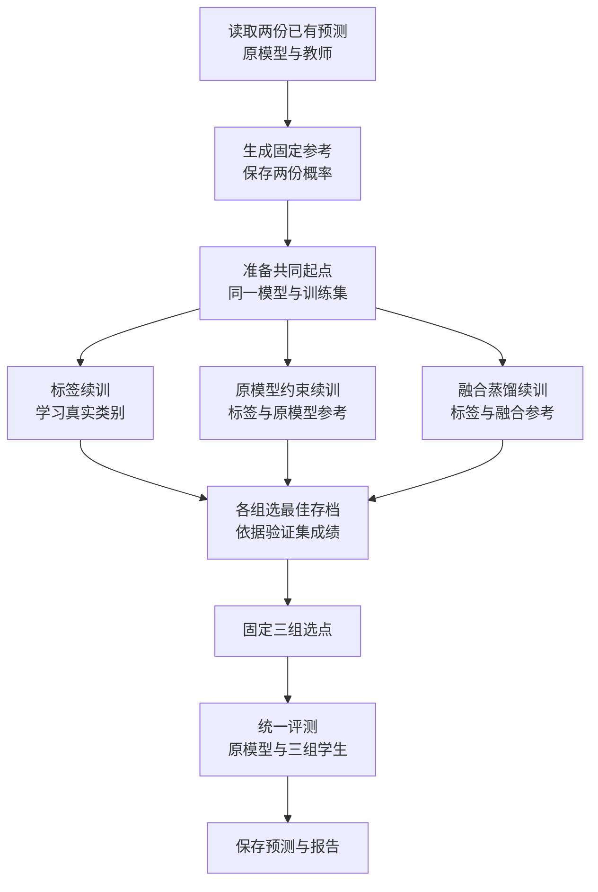
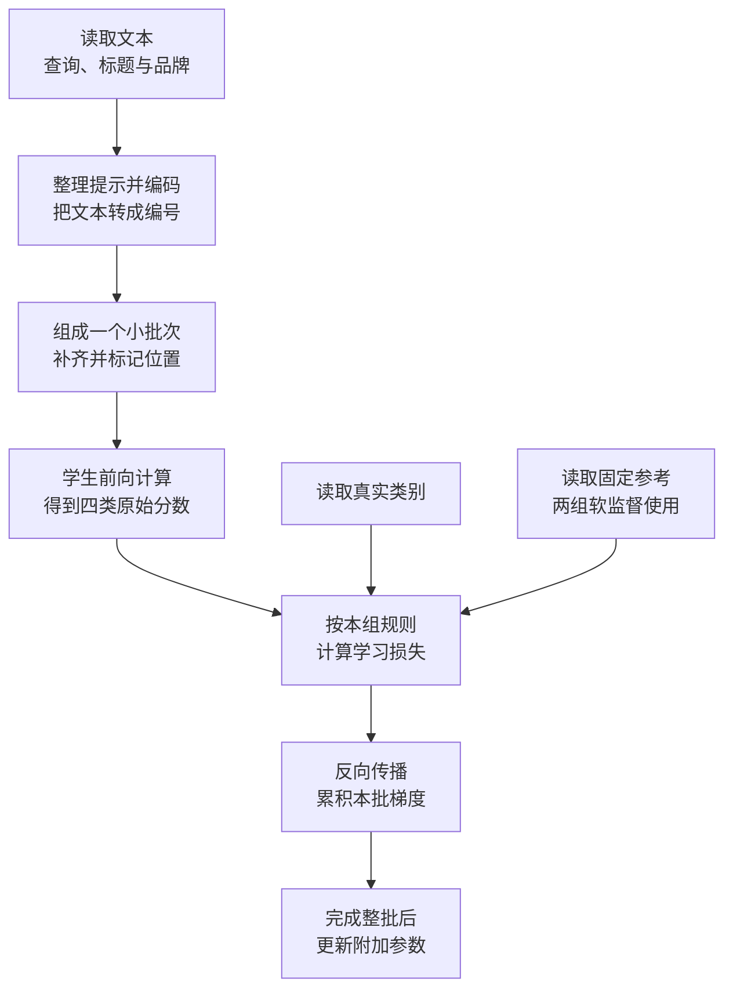
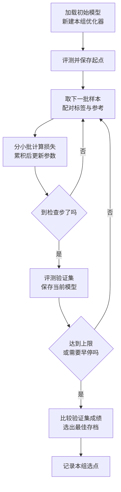

# 目录与复现说明：第一次读代码，从哪里开始

这个项目让模型判断：用户搜索一件商品时，某个候选商品是满足需求、可以替代、配套使用，还是无关。本轮已经有一个经过任务训练的小模型，叫作**原模型 S**；我们从它出发，比较三种继续训练的方法，希望把原模型与 DeepSeek 组合后的部分能力教给一个能独立运行的小模型。

[《从入门到掌握》](从入门到掌握.md)解释这项实验为什么这样做。本文接着回答：**打开项目后先看哪些文件，一条数据怎样经过这些代码，以及运行后到哪里找结果。** 下面对应的是 2026-10-21 已完成的 CE_CONT / REF_KD / FUSION_KD 实验。

如果只是第一次读代码，可以先读第 1～4 节；想查看已有成绩，读第 5 节；准备自己运行，再读第 6 节。

## 1. 先看清程序要完成的事情

先认识三组学生的名字。它们各自从原模型 S 的同一份参数开始，使用相同的训练样本，区别在于学习时参考什么：

| 代码中的组名  | 本文的叫法   | 每条样本的学习依据                                       |
| ------------- | ------------ | -------------------------------------------------------- |
| `CE_CONT`   | 标签续训组   | 数据集给出的真实类别                                     |
| `REF_KD`    | 原模型约束组 | 真实类别，以及原模型 S 的四类概率                        |
| `FUSION_KD` | 融合蒸馏组   | 真实类别，以及按固定规则组合原模型与教师后得到的四类概率 |

这里的“参考概率”已经保存在文件中。学生训练时读取这些数，更新自己的参数。原模型和教师的缓存概率保持不变。

四类概率始终按 E、S、C、I 排列，分别对应满足需求、可以替代、配套使用和无关。类别 S 与“原模型 S”是两种含义，阅读时按上下文区分。

下面先看整个过程。**本文流程图的方框统一用中文说明正在做什么；具体文件和函数放在图后的讲解中。** 箭头表示数据流向或下一步，菱形表示需要作出判断。



图中的三个分支表示三组独立实验。实际程序依次训练三组；后一组重新从原模型 S 开始。目标准备是训练前的单独一步，已有完整目标文件时，可以直接从检查输入开始。

图里还有两个后面会反复遇到的词：

- **模型存档（checkpoint）**：保存某个训练时刻的模型参数。在这个项目里，模型的附加可训练参数叫 **LoRA adapter**；使用模型时，还需要 Qwen3-0.6B 底座。
- **验证集 tune**：训练中定期拿来检查效果、选择模型存档的一批数据。`gate` 和 `F` 则在三组选点完成后用于评测；最终评测也会重新汇总 tune 成绩。

## 2. 打开目录，先分清输入、代码和输出

```text
ESCI/
├── src/
│   ├── train.py          唯一 CLI：sft / fusion 分发
│   ├── sft.py            官方底座 → S
│   ├── fusion.py         固定目标、三组续训、选点与评测
│   ├── evaluation.py     查询隔离、弃权指标和 NLL
│   ├── common.py         数据契约、编码、指标、路由与融合
│   └── modeling.py       Qwen + LoRA 前向、保存与预测
├── configs/              两阶段冻结配方与模型锁
├── data/                 SFT 划分、续训样本、冻结概率目标、F
├── models/               官方底座与固定 S adapter
├── results/              已发布报告与冻结教师缓存
├── runs/                 新训练作业、checkpoint、预测与报告
├── scripts/              Linux 预检和运行包装
└── docs/                 当前讲解及标注为历史的记录
```

`data/`、`models/`、`results/` 是本轮重构的只读基准；新的运行输出放在 `runs/`。阶段一默认产出 `runs/train_sft/models/S`，阶段二读取配置固定的 `models/S`，两者不会自动替换。

## 3. 第一次读源码，按这个顺序往下走

本节按“数据怎样流动”讲，适合先建立整体印象。若想打开文件逐个函数读——每个函数的输入输出、行号、张量形状、为什么这样写、以及可以自己执行的核对命令——用[源码导读](源码导读/README.md)；那套文档覆盖 `train.py`、`sft.py`、`fusion.py`、`modeling.py`、`common.py`、`evaluation.py` 六个文件。

### 3.1 先找入口：命令由谁接住

[train.py](../src/train.py) 只分发子命令：`sft` → `sft.main()`，`fusion` → `fusion.main()`。阶段一的参数与输入检查由 [sft.py](../src/sft.py) 负责，阶段二的参数与流程由 [fusion.py](../src/fusion.py) 负责。

| 命令 | 后续调用 |
| --- | --- |
| `python src/train.py sft --check-only` | `verify_inputs()`、官方底座身份核验；不训练 |
| `python src/train.py sft --output runs/sft_new` | `train_sft()`；底座 → S |
| `python src/train.py fusion --preflight` | `audit()`、合成 CPU 检查、tokenizer 核验 |
| `python src/train.py fusion --gpu-check` | 预检后加载 S 做少量前向 |
| `python src/train.py fusion --train --evaluate --output runs/fusion_new` | `train()` → `train_arm()` × 3 → `final_evaluation()` |

两阶段都支持 `--help`。`fusion` 不带选项时执行预检，不会开始训练。SFT 可通过 `--config` 指定已有配方；Fusion 固定读取 [fusion_continue_20261021.json](../configs/fusion_continue_20261021.json)。

### 3.2 再跟一条样本：文本怎样变成模型输出

训练样本保存在 `data/posttraining/train.jsonl`。**JSONL 是每行一条 JSON 记录的文本文件**；`common.read_jsonl()` 读完后，每条记录就成为 Python 字典，通过字段名取值。

下面是一条简化的教学记录，省略了真实文件中的其他字段。为方便阅读，这里展开成多行；在 JSONL 文件中，一条记录占一行：

```json
{
  "example_id": "demo-1",
  "query_id": "query-demo",
  "product_id": "product-demo",
  "query": "无线鼠标",
  "title": "无线办公鼠标",
  "brand": "示例品牌",
  "label": "E"
}
```

`query` 是用户搜索词，`title` 是商品标题，`brand` 是品牌。`label` 是真实类别；`example_id` 等身份字段用于核对样本对应关系。模型输入只使用查询、标题、品牌，真实类别留给后面的损失计算。



图中的“前向计算”就是用当前模型算出结果；“损失”是衡量学习差距的数；“反向传播”计算各参数对损失的影响，得到梯度，供优化器调整参数。沿图读代码时，对照下面四步即可：

1. **文本变数字。** [common.py](../src/common.py) 的 `payload()` 取出三个文本字段，`encode()` 加上任务提示，再调用 tokenizer。tokenizer 把文本切成模型认识的单位并转成编号，得到 `input_ids`；`attention_mask` 标记有效输入位置。
2. **几条样本组成一批。** `collate()` 把长度不同的编号序列补齐，并转成张量。张量可以先理解为能在 GPU 上运算的数值数组；补齐位置在 `attention_mask` 中记为 0。
3. **模型计算四个分数。** [modeling.py](../src/modeling.py) 的 `RelevanceModel.forward()` 处理输入，取最后一个有效位置的表示，用原有词表输出层中 E、S、C、I 对应的四行权重，算出四个原始分数，代码称为 `logits`。它们还不是概率。
4. **计算学习差距。** [fusion.py](../src/fusion.py) 的 `loss_rows()` 把四个分数转成对数概率，结合真实标签和参考概率计算每条样本的损失。训练循环拿到损失后，再反向传播、更新参数。

训练中看到 `logits = model(batch)`，就可以沿着它找到 `RelevanceModel.forward()`。评测时则走 `predict()` → `infer()`，由 `infer()` 对四个分数做 softmax 得到四类概率，再由 `predict()` 生成分类结果与商品排序分数。

这条路径直接计算 E、S、C、I 的概率，模型不需要先生成一段回答，再从回答中提取类别。

### 3.3 参考概率怎样与样本对上

训练还会读取 `data/fusion_continue_20261021/targets.jsonl`。每条记录保存样本身份和两份概率：

| 文件字段                    | 含义                               | 哪一组用它学习 |
| --------------------------- | ---------------------------------- | -------------- |
| `reference_probabilities` | 原模型 S 的固定概率，记作 `p_S`  | 原模型约束组   |
| `fusion_probabilities`    | 事先算好的融合参考概率，记作 `q` | 融合蒸馏组     |

`audit()` 会检查训练行与目标行的身份、标签和顺序是否对应。进入 `train_arm()` 后，程序按 E、S、C、I 的顺序，把目标字段里的四个数排成张量；每次抽取训练样本时，同时抽取对应位置的真实标签与参考概率。

例如，一条融合参考可以是 `[0.60, 0.225, 0.10, 0.075]`。全体 10,398 条样本组成 `[10398, 4]` 的概率表；正常一次取 4 条，就得到 `[4, 4]` 的小表，传给 `loss_rows()` 的 `target` 参数。参考概率本来就是数字，不需要经过 tokenizer。

三组进入同一个损失函数，但使用的学习要求不同：

| 组            | 本轮每条样本的损失                |
| ------------- | --------------------------------- |
| `CE_CONT`   | `CE(y, p)`                      |
| `REF_KD`    | `(CE(y, p) + KL(p_S ∥ p)) / 2` |
| `FUSION_KD` | `(CE(y, p) + KL(q ∥ p)) / 2`   |

这里 `y` 是真实类别，`p` 是学生当前的概率。CE 促使学生提高真实类别的概率；KL 促使学生的四类概率接近参考。公式的数值例子和设计理由见[《从入门到掌握》第 5 节](从入门到掌握.md#5-把学习要求写成损失)。

代码会为 CE_CONT 也读取参考张量并计算 KL 记录值，但它的训练损失只取 CE，KL 不参与这一组的参数更新。

### 3.4 最后看循环：什么时候更新、保存和停止

回到 [fusion.py](../src/fusion.py) 的 `train_arm()`。这是“训练其中一组”的完整过程，参数 `arm` 表示本次训练哪一组。

正常情况下，每次前向处理 4 条样本，累计处理 32 条后更新一次参数；这种把多次小批计算的梯度合起来再更新的方式，叫**梯度累积**。每遍最后剩 30 条时，按这 30 条的实际数量平均。



`optimizer` 是负责更新参数的优化器，本轮用 AdamW。循环里，`backward()` 累积梯度，`optimizer.step()` 执行一次参数更新；`evaluate_point()` 检查 tune 成绩，`snapshot()` 保存可供评测或恢复的存档。

如何选、何时停，规则在 `fusion.py` 中：`best_key()` 优先选 tune Macro-F1 最高的存档，并列时看 nDCG@10，再取较早步；`stop_state()` 判断是否达到早停条件。两个指标分别关注四类分类的均衡表现和商品排序质量。

本轮最多更新 650 次，验证集检查步是 0、82、163、244、325、407、488、569、650。三组实际都跑到 650 步，未触发早停；最后选出的最佳存档可以早于 650 步。完整规则见[当前训练流程](当前训练流程.md)。

三组完成后，`train()` 写出 `selected_all.json`，集中记录选中了哪些存档。随后 `final_evaluation()` 加载原模型 S 和三个已选模型，分别预测 tune、gate、F，再调用 `evaluation.evaluation_metrics()` 计算成绩，并用 `paired_bootstrap()` 比较同一批查询上的模型差值。

## 4. 训练之前，固定参考概率是谁准备的

第 3 节从现成的 `targets.jsonl` 开始读。若想继续追溯这个文件，打开 [fusion.py](../src/fusion.py) 的 `prepare()`。

它读取三份已有资料：本轮训练样本、原模型 S 的历史概率、教师的历史概率。先核对这些记录是不是同一条样本，再按下面的规则写出融合参考：

1. 取每条样本的原模型四类概率中的最大值，作为原模型对这条样本的置信度。
2. 按置信度从低到高选出一半样本，优先在原模型拿不准的地方引入教师。这一步叫路由。
3. 对被选中且有有效教师概率的样本，逐类平均两份概率；其余样本沿用原模型概率。

把教师概率记作 `p_T`，则 `q = (p_S + p_T) / 2` 只用于选中且教师有效的样本，其余为 `q = p_S`。全部 10,398 条都有参考概率：5,195 条使用两份概率的平均，5,203 条使用原模型概率。

路由与平均的具体实现来自 [common.py](../src/common.py) 的 `low_confidence_indices()` 和 `fuse()`。`prepare()` 负责把这些操作组织起来，写出 `targets.jsonl` 和对应的 `manifest.json`。

**manifest 是一份文件清单和校验记录。** 其中的 SHA256 可以理解为根据文件内容算出的指纹，用来检查后面读取的输入是否仍是同一份。`audit()` 会重新核对指纹、样本身份、概率和路由结果。

目标准备复用已有概率，不加载模型，也不发送新的教师请求。它依赖的原始概率归档与普通训练输入不同，具体要求见第 6.3 节。

## 5. 看结果时，应该打开哪个文件

### 5.1 先看已经整理好的报告

本轮公开结果在 [results/fusion_continue_20261021](../results/fusion_continue_20261021/RESULT.md)。第一次看，按下表顺序打开就能逐步回答“成绩怎样、选了谁、用了什么输入和环境”：

| 文件                                                                            | 它回答的问题                                              |
| ------------------------------------------------------------------------------- | --------------------------------------------------------- |
| [RESULT.md](../results/fusion_continue_20261021/RESULT.md)                       | 实验得到什么结果，如何解释？                              |
| [report.json](../results/fusion_continue_20261021/report.json)                   | 每个模型在各划分的具体成绩、每类 F1、模型差值区间是多少？ |
| [selected_all.json](../results/fusion_continue_20261021/selected_all.json)       | 各组选了第几步，存档相对路径是什么，训练最后停在第几步？  |
| [run_manifest.json](../results/fusion_continue_20261021/run_manifest.json)       | 这次实际用了哪份代码、配置、输入和运行环境？              |
| [target_manifest.json](../results/fusion_continue_20261021/target_manifest.json) | 参考概率怎样准备，有多少样本引入了教师，输入指纹是什么？  |

`report.json` 中，`metrics` 保存分数，`paired_query_bootstrap` 保存模型差值和区间，`selections` 保存选点。百分比通常以小数存储，例如 `0.4922` 约等于 49.22%。

`target_manifest.json` 是准备目标时的快照，所以其中的 `training_not_started` 描述的是那个时间点。是否已经训练完成，要继续看运行、选点和结果记录。

### 5.2 自己运行后，输出是什么样

假设运行时指定 `--output runs/fusion_new`，程序会把这次作业写入下面的目录。`fusion_new` 是示例名，可以改成自己的新目录名。

```text
runs/fusion_new/
├── run_manifest.json                  本次作业的配置、文件指纹与环境
├── selected_all.json                  三组选中的模型
├── CE_CONT/                           标签续训组
├── REF_KD/                            原模型约束组
├── FUSION_KD/                         融合蒸馏组；三组内部结构相同
│   ├── updates_时间戳.jsonl           每次更新的损失、学习率等
│   ├── tune_step_0488.jsonl           某个检查步的验证集逐条预测
│   ├── step-0488/                     该检查步的模型与恢复状态
│   │   ├── adapter/                   训练得到的 LoRA 参数
│   │   ├── tokenizer/                 保存的分词器
│   │   ├── training_state.pt          优化器与随机数状态，用于恢复
│   │   └── state.json                训练步数、历史成绩和校验信息
│   └── selected.json                 这一组的选点结果
└── evaluation/
    ├── FUSION_KD_F.jsonl              融合学生在 F 上的逐条预测
    ├── FUSION_KD_F.meta.json          这份预测对应哪个模型及其校验信息
    ├── report.json                   所有模型和划分的成绩与比较
    └── RESULT.md                     自动生成的成绩表
```

这里省略了其他检查步、其他模型的预测和部分辅助文件。实际运行不会自动把输出复制到 `results/`；先去自己指定的 `runs/.../evaluation/` 找报告。

本地已有运行的日志和预测在 `runs/fusion_continue_20261021/`。该目录保留的是回收结果，模型 checkpoint 仍在原执行主机的本次运行目录中；有 `selected_all.json` 不等于本机已有它指向的权重。

若只想核对本轮关键数值：FUSION_KD 在 F 上的 Macro-F1 为 49.22%，CE_CONT 为 48.31%，REF_KD 为 48.18%；选点分别是 488、569、569 步，实际三组都训练到 650 步。

## 6. 从只读代码，到真正复现，分别怎么做

### 6.1 只有公开仓库：先运行帮助，读取已有结果

以下命令都从项目根目录执行。本机位置是 `D:\Projects\ESCI`；在其他机器上换成自己的项目位置。

```powershell
cd D:\Projects\ESCI
python src/train.py --help
python src/train.py sft --help
python src/train.py fusion --help
```

成功时会看到 `usage:` 和参数列表。这些帮助命令只检查 Python 能否找到脚本并显示帮助，不需要模型权重，也不会开始训练。

已经发布的 `report.json` 可以直接用编辑器打开，也可以用下面这条命令读取 FUSION_KD 的三个指标。它只使用 Python 标准库：

```bash
python -c "import json; from pathlib import Path; r=json.loads(Path('results/fusion_continue_20261021/report.json').read_text(encoding='utf-8')); m=r['metrics']['F']['FUSION_KD']; print({k:m[k] for k in ('accuracy','macro_f1','ndcg10')})"
```

应看到约 `0.5573`、`0.4922`、`0.7698`。这是**读取已经计算好的结果**。要重新计算指标，需要逐条预测；要重新训练或让模型重新预测，还需要数据、权重和相应环境。

### 6.2 准备完整输入与训练环境

当前代码按固定输入运行，主要文件如下。具体路径也能在配置中找到。

| 需要的文件                                                         | 用途                                         |
| ------------------------------------------------------------------ | -------------------------------------------- |
| `models/base/`                                                   | 固定版本的官方 Qwen3-0.6B 底座与分词器       |
| `models/S/adapter/`                                              | 三组共同使用的初始 LoRA 参数及配置           |
| `data/posttraining/train.jsonl`                                  | 10,398 条本轮训练样本及标签                  |
| `data/posttraining/teacher.jsonl`                                | 已有教师概率，准备和核对目标时使用           |
| `data/fusion_continue_20261021/targets.jsonl`、`manifest.json` | 固定参考概率及其校验清单                     |
| `data/sft/tune.jsonl`、`gate.jsonl`                            | 选点数据和额外评测数据                       |
| `data/final/input.jsonl`、`gold.jsonl`                         | F 的商品输入和对应真实标签                   |
| `results/final/predictions/T/F_predictions.jsonl`                | F 的教师缓存，用于报告中的教师与融合系统参照 |

最后一项虽然在历史结果目录中，仍被当前配置引用。当前代码会核对文件指纹，因此相同文件名或相同样本数还不足以满足输入要求；需要与记录对应的内容。重新训练一个 S，也会得到另一份初始模型。

已完成实验使用 Linux、Python 3.12.3、torch 2.8.0+cu128 和 RTX 4080 SUPER，模型计算要求支持 CUDA BF16。完整版本记录在 [run_manifest.json](../results/fusion_continue_20261021/run_manifest.json)。先准备与 GPU 匹配的 PyTorch，再安装其余依赖：

```bash
python -m pip install -r requirements-fusion.txt
```

[requirements-fusion.txt](../requirements-fusion.txt) 固定了 transformers、PEFT 等依赖，PyTorch 另行安装。模型通过本地路径加载，因此权重也要提前放好。环境设置与输入身份的详细说明见[训练与评测](训练与评测.md)。

### 6.3 已有参考文件就继续

`targets.jsonl` 和对应 manifest 齐备后直接预检。目标构造函数 `fusion.prepare()` 保留原实现，读取 `ARCHIVE` 指定的原 S 历史概率及教师缓存；它只用于准备全新的目标目录，并拒绝覆盖非空目录。当前 CLI 不自动重建输入，本次重构也不执行该函数。

### 6.4 先检查输入，再启动训练

输入和依赖齐备后，先执行：

```bash
python src/train.py fusion --preflight
python src/train.py fusion --gpu-check
```

第一条检查数据、概率、模型身份、输入长度和损失计算，成功输出 `PASS_CPU_PREFLIGHT`。第二条还会加载 S，对 8 条样本做前向计算，成功输出 `PASS_GPU_PREFLIGHT`。两者都不更新模型；CPU 预检仍需要完整的本地输入与依赖。

通过后，用一个新的输出目录运行三组训练和最终评测：

```bash
python src/train.py fusion --train --evaluate --output runs/fusion_new
```

运行中会看到三组的更新记录和 `TUNE` 成绩。出现 `ALL_SELECTIONS_FROZEN` 表示三组选点已写好；之后的 `EVALUATED` 表示某个模型在某个划分的成绩已汇总。完整结果保存在 `runs/fusion_new/evaluation/report.json`。

命令同时带 `--train` 和 `--evaluate` 时，先完成全部三组训练，再开始统一评测。新运行结束后，检查 `selected_all.json` 中的选点、`run_manifest.json` 中的环境，以及报告中的样本数和指标，才能与已发布结果比较。

### 6.5 中断后恢复，或只重新评测

重构前的运行清单不再用于恢复；同一份新代码启动的作业中，恢复同一次作业时，沿用原输出目录并加上 `--resume`：

```bash
python src/train.py fusion --train --evaluate --resume --output runs/fusion_new
```

程序从最近一个完整保存的 checkpoint 恢复模型、优化器和随机数状态；已经完成的组读取原有选点。两个存档之间尚未保存的更新会重新执行。恢复前还会核对代码、输入、配置和环境是否与本次作业一致。

若三组选点已经完成、对应 checkpoint 也在，可以单独执行：

```bash
python src/train.py fusion --evaluate --output runs/fusion_new
```

这条命令仍要求 GPU、底座、原模型 S 和选中的 adapter，也会通过 `audit()` 检查完整冻结输入，包括训练数据和目标文件。它会校验并复用身份一致的已有预测，对缺少的预测加载模型计算，然后重新汇总报告。

### 6.6 只有汇总报告，能复现到哪一步

| 手里的材料                                                 | 能做什么                                   |
| ---------------------------------------------------------- | ------------------------------------------ |
| 公开的 `report.json` 等汇总文件                          | 读取成绩、核对差值、查看选点和运行记录     |
| 逐条预测及对应标签                                         | 重新计算指标，并按查询重新抽样计算差值区间 |
| 完整输入、环境和初始模型 S                                 | 重新训练三组，再选点和评测                 |
| 完整输入、原运行环境、运行记录、原模型 S 及已选 checkpoint | 用 `--evaluate` 执行模型评测与报告汇总   |

查询配对区间需要保留“哪个查询下有哪些商品、两个模型分别预测了什么”的信息，单凭几个汇总分数不能还原。当前入口没有单独的“仅凭预测文件离线复算”选项；阅读相关实现时，找 `evaluation_metrics()` 和 `paired_bootstrap()`。

## 7. 历史对照表

| 内容或位置 | 当前归属与状态 |
| --- | --- |
| 官方底座 → S | `python src/train.py sft`，实现为 `sft.main()` / `train_sft()` |
| S → CE_CONT / REF_KD / FUSION_KD | `python src/train.py fusion`，实现集中于 `fusion.py` |
| 固定目标、损失与选点 | `fusion.prepare()` / `loss_rows()` / `best_key()` |
| 查询隔离与评测 | `evaluation.py`；共用 `common.metrics()` |
| 2026-10-21 已完成续训结果 | `results/fusion_continue_20261021/`，数字与文件保留 |
| 更早的监督、门控、底座直训方案 | 标注“历史”的文档；对应旧源码已删除，不作为当前运行入口 |
| 历史教师缓存 | `results/final/predictions/T/F_predictions.jsonl`，当前继续只读复用 |
| 历史运行清单 | 保留证据；不兼容新源码身份，不用于恢复新运行 |

此前删除的 16 个源码文件不恢复。当前目录只有 6 个 Python 文件，模块职责见[源码索引](../src/README.md)，历史记录索引见[文档目录](README.md)。
